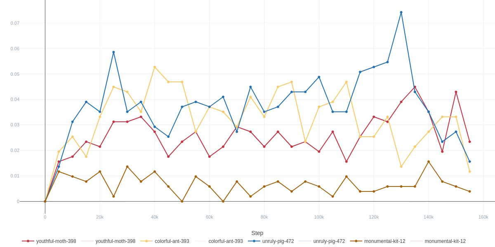
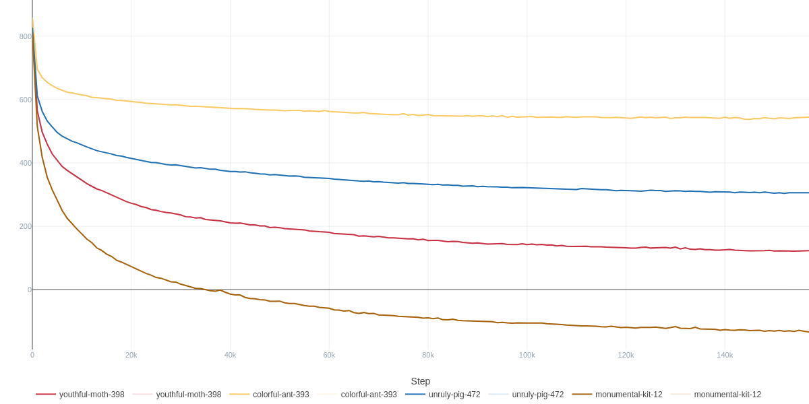
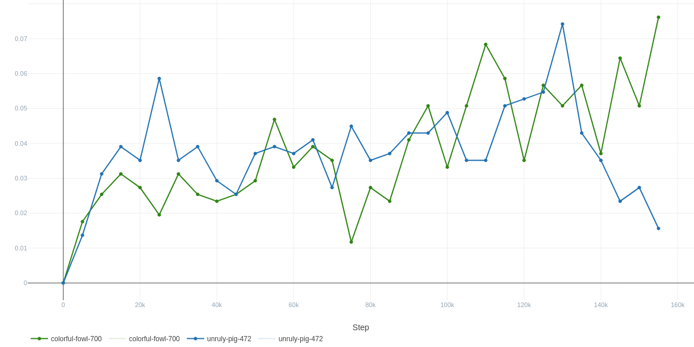
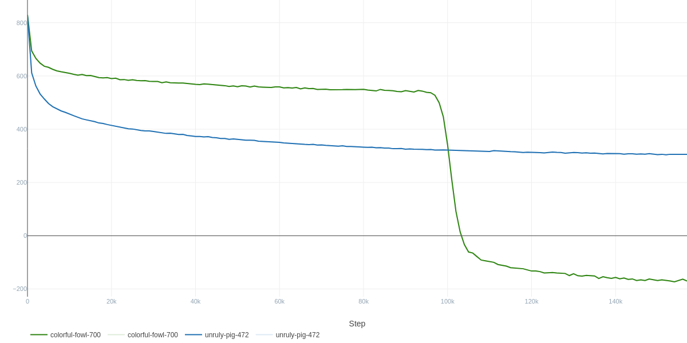

# Belief Network Target Dequantization

This is still in progress, just logging what I have so far!

## Noise Variants

### Fixed Gaussian Noise
The first runs added gaussian noise to the targets with gain factors of 0.1, 0.2, 0.3, and 0.5 and evaluated based on the fraction of the conditional flow's probability mass covering the true hidden cards.


Figure: probability mass on true cards across training iterations for gain factors of 0.1 (orange), 0.2 (red), 0.3 (blue), and 0.5 (yellow).

A gain of 0.3 seemed to perform best with increasing the gain further to 0.5 showing little marginal improvement.


Figure: validaton loss curves for gain factors of 0.1 (orange), 0.2 (red), 0.3 (blue), and 0.5 (yellow).

### Noise Schedules
I also tried adding noise on schedule:

```
0.5*(DQ_NOISE_SCHEDULE_CEILING-DQ_NOISE_SCHEDULE_FLOOR)*(math.tanh(DQ_NOISE_SCHEDULE_DROP_FACTOR*(DQ_NOISE_SCHEDULE_INFLECTION_POINT-step)) + 1) + DQ_NOISE_SCHEDULE_FLOOR`
```

The following schedule parameters were selected based on the observation that mass-on-true started to collapse around iteration 100,000 with fixed noise:
```
DQ_NOISE_SCHEDULE_DROP_FACTOR = 0.0005
DQ_NOISE_SCHEDULE_CEILING = 0.5
DQ_NOISE_SCHEDULE_FLOOR = 0.1
DQ_NOISE_SCHEDULE_INFLECTION_POINT = 100000
```

Applying a schedule 


Figure: probability mass on true cards across training iterations for a fixed gain of 0.3 (blue) vs scheduled noise that decays from 0.5 to 0.1 (green).


Figure: validation loss curves for for a fixed gain of 0.3 (blue) vs scheduled noise that decays from 0.5 to 0.1 (green).

## Data Reproduction

Train Dataset: `uv run scripts/generate_dumps.py --out /tmp/magicnet/premodern_3 --games 4000 --shares forge-bridge/fixtures/premodern/shares_placeholder.csv --workers 1 --heap 1536m --seed 9481`

Validation Dataset: `uv run scripts/generate_dumps.py --out /tmp/magicnet/premodern_2 --games 1000 --shares forge-bridge/fixtures/premodern/shares_placeholder.csv --workers 1 --heap 1536m`